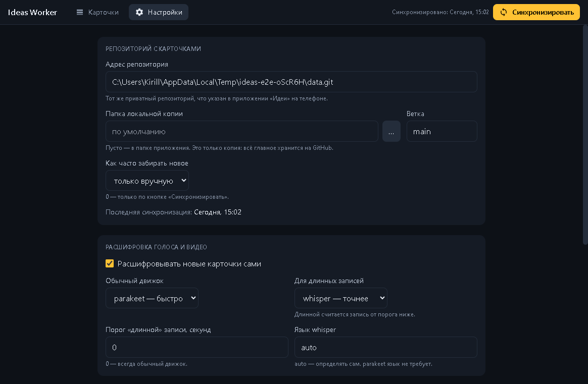

# Ideas Worker

Приложение для Windows, которое разбирает идеи, записанные на телефоне в приложении
[«Идеи»](https://bablakov.github.io/ideas-iphone/). Забирает карточки из вашего приватного репозитория,
**расшифровывает голос и видео прямо на вашем компьютере**, делает конспекты и возвращает результат обратно,
чтобы он был виден на всех устройствах.

Записали идею на ходу → вечером открыли Ideas Worker → получили текст, конспект и разобрали карточки.

[](https://github.com/Bablakov/ideas-worker-app/releases/latest)



---

## Что оно делает

- **Забирает карточки с телефона.** Голос, видео, текст и ссылки из приложения «Идеи» — через ваш приватный
  репозиторий на GitHub. Большие записи, которые телефон отправляет кусками, склеиваются автоматически, а
  контрольная сумма каждого куска проверяется: повреждённый файл не пройдёт молча.
- **Расшифровывает сам.** Новые карточки с голосом или видео ставятся в очередь и расшифровываются по одной.
  Движок: parakeet (быстро) или whisper (точнее с пунктуацией; можно включать для длинных записей).
- **Делает конспект по кнопке.** Заголовок и список основных мыслей — локальной моделью. Модель только
  сжимает сказанное, фактов не добавляет.
- **Ведёт статусы.** «Обработана», «В архив», «Вернуть» — меняются здесь и сразу видны на телефоне.
- **Ничего не теряет и не затирает.** Исходный текст карточки и расшифровка никогда не перезаписываются
  конспектом, у каждого свой файл. Удалить карточку навсегда можно только с телефона; «В архив» — это статус.
- **Всё локально.** Распознавание и конспекты считаются на вашем компьютере, записи никуда не отправляются.
  Единственный обмен с интернетом — ваш собственный приватный репозиторий на GitHub.
- **Запускается, когда нужно.** Не лезет в автозапуск и не висит в фоне: открыли, разобрали, закрыли.

---

## Установка

1. Скачайте `ideas-worker-x.y.z-setup.exe` со страницы
   [Releases](https://github.com/Bablakov/ideas-worker-app/releases/latest).
2. Запустите. Права администратора не нужны — приложение ставится в вашу папку пользователя, можно выбрать
   другую. На рабочем столе появится ярлык.
3. Убедитесь, что на компьютере есть **git** с сохранённым входом в GitHub (подробнее ниже).

> **Windows может предупредить о неизвестном издателе.** Установщик не подписан сертификатом: подпись стоит
> денег и для домашнего приложения избыточна. Нажмите «Подробнее» → «Выполнить в любом случае».

Подробная пошаговая инструкция: [docs/install.md](docs/install.md)

---

## Быстрый старт

1. **Телефон.** Откройте [приложение «Идеи»](https://bablakov.github.io/ideas-iphone/), добавьте на домашний
   экран, во вкладке «Настройки» вставьте токен GitHub для вашего приватного репозитория с данными.
2. **Компьютер.** Установите Ideas Worker. В «Настройках» укажите адрес того же репозитория.
3. Запишите идею на телефоне и нажмите «Синхрон.».
4. В Ideas Worker нажмите **«Синхронизировать»** — карточка появится слева, расшифровка начнётся сама.

Подробнее со схемой и проверкой связки: [docs/setup.md](docs/setup.md)

---

## Что нужно на компьютере

| Что | Зачем | Где взять |
|---|---|---|
| **git** + вход в GitHub | забирать и отправлять карточки | [git-scm.com](https://git-scm.com/download/win); вход — при первом обращении к репозиторию |
| **ffmpeg** | подготовка звука для распознавания | ищется сам, либо укажите `ffmpeg.exe` в «Настройках» |
| **parakeet** или **whisper** | расшифровка речи | ищутся сами, либо укажите пути в «Настройках» |
| **llama-server + модель** | конспекты (необязательно) | запускается кнопкой в «Настройках» |

Приложение **не скачивает модели и движки само**: ищет их там, где они уже лежат, а чего не нашло, просит
указать. Без движков карточки всё равно приходят и читаются — просто без расшифровки.

---

## Как работает связка

```
телефон («Идеи»)        ваш приватный репозиторий           компьютер (Ideas Worker)
 запись, видео, текст ──►  inbox/<id>/item.json      ──►   забрать → склеить файлы
                           inbox/<id>/audio.000…            → расшифровать → конспект
                      ◄──  transcript.txt, summary.md ◄──  записать результат, сменить статус
```

Телефон и компьютер не знают друг о друге — их связывает только ваш приватный репозиторий. Поэтому компьютер
может быть выключен хоть неделю: ничего не потеряется, всё догонится при следующем запуске.

---

## Приватность

- Данные лежат только в **вашем приватном** репозитории GitHub и на ваших устройствах.
- Приложению не нужны токены или пароли: вход в GitHub берётся из того, что уже настроено в git на вашем
  компьютере. Токен нужен только приложению на телефоне.
- Распознавание речи и конспекты работают на вашем компьютере и не требуют интернета.

---

## Если что-то не работает

| Что видите | Что делать |
|---|---|
| «git не установлен» в настройках | поставьте [git](https://git-scm.com/download/win) и перезапустите приложение |
| Ошибка синхронизации про доступ или пароль | проверьте вход: `git ls-remote <адрес репозитория>` в терминале должен проходить без вопросов |
| «Не найден движок расшифровки» | укажите пути к parakeet или whisper и их моделям в «Настройках» |
| «Телефон ещё не догрузил карточку целиком» | на телефоне нажмите «Синхрон.» и дождитесь конца, потом повторите здесь |
| «Файл повреждён: контрольная сумма не совпала» | на телефоне нажмите «Отправить мою версию на GitHub» в настройках — карточка загрузится заново |
| Конспект не делается | в «Настройках» нажмите «Запустить» у локальной модели; в первый раз она грузится до нескольких минут |

Больше: [docs/install.md](docs/install.md#если-что-то-пошло-не-так)

---

## Ограничения

- Только Windows.
- Телефон пока не показывает расшифровку и конспект — они видны в Ideas Worker.
- Картинки к идеям и выгрузка в другие сервисы пока нет.

История версий: [CHANGELOG.md](CHANGELOG.md)
